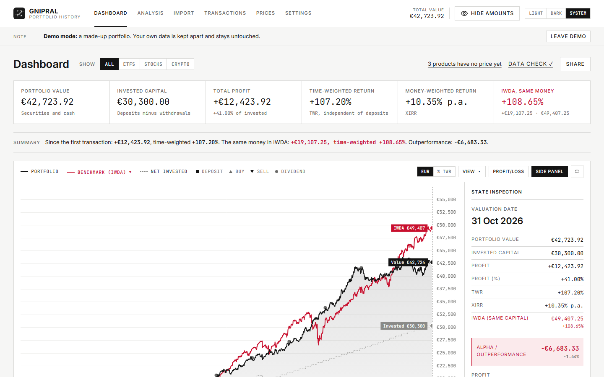
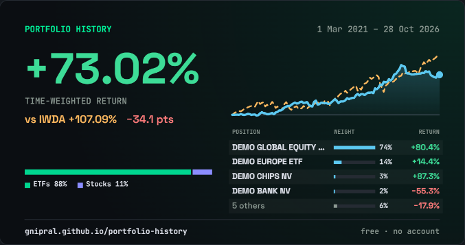
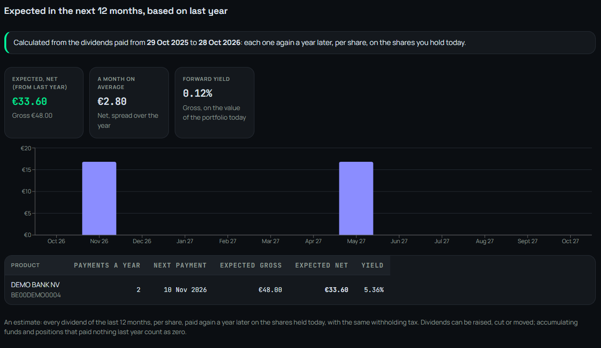

<p align="center">
  <picture>
    <source media="(prefers-color-scheme: dark)" srcset="public/brand/gnipral-lockup-dark.svg">
    
  </picture>
</p>

# Portfolio History

A Progressive Web App that reconstructs the value and profit of an investment portfolio over time from a broker export. Everything runs in the browser; portfolio data never leaves the device, unless you save it to the optional account.

Live app: https://gnipral.github.io/portfolio-history/

No broker export at hand? Open the app and press **Try the demo**: a made-up portfolio that needs no connection, no account and no file. Feedback and ideas are welcome in the [issues](https://github.com/Gnipral/portfolio-history/issues).



| Share your return, never your amounts | What the next 12 months will pay |
|---|---|
|  |  |

The screenshots show the demo portfolio; all names and numbers in it are made up.

## What it does

1. **Import** a broker export (CSV, XLSX, XML or PDF). The file is read in the browser and stored in IndexedDB.
2. **Prices** are fetched once per day for every product you ever held, together with splits and EUR exchange rates, and cached in the browser.
The interface reads like a report: numbered sections, thin rules, figures in a tabular monospace font, and grayscale with one colour for the benchmark. Gains and losses are told apart by their sign. Light is the default; dark is the same grayscale inverted, or follows the device. The header shows today's total value, **Hide amounts** (every amount and quantity becomes •••, percentages stay), the offline badge, the theme and the account. Every notice (offline, demo mode, missing price history, a new version) goes in one strip under the navigation. The layout is made for desktop (up to 1440px wide); on a phone everything still works.

3. The **dashboard** rebuilds the portfolio for every calendar day since the first transaction:
   - the figures of the **selected period**: value at its end, invested capital, profit in euros and percent, time-weighted return (TWR), money-weighted return (XIRR) and the same money in the benchmark, with a sentence that sums it up;
   - a chart of value, invested capital and the benchmark, in euros or as TWR, with markers for deposits, buys, sells and dividends. Its toolbar holds the legend (click **Benchmark** to compare with IWDA, VWCE, SXR8, your own mix or any stock or index found with the search), a **View** menu (fill, invested capital line, log scale, palette: Standard, Colour-blind friendly or High contrast), the profit/loss pane, the side panel and full screen. The line labels stand at their points; zoom with the mouse wheel or two fingers;
   - the **State inspection** side panel: the figures of one day (value, invested, profit, TWR, XIRR, the benchmark with the same capital and the alpha), the profit of that day, month, year and since the start, the best and worst position, and cash, unrealized and realized results. It follows the mouse over the chart; a click pins the day ("Pinned ×"), and clicking a marker also shows that day's transactions;
   - a **timeline** like a video editor: the whole history with two handles for the start and end of the period, a draggable window and a playhead for the day shown, From/To dates, quick ranges 1M · 3M · YTD · 1Y · 3Y · ALL, and ←/→ (Shift for a month) to move the playhead. The period is shared with Analysis;
   - saved periods: the window shown saved under a name ("After the crash") and opened again with one click; a period up to today grows along;
   - a filter on the type of asset (ETFs, stocks, crypto, …): the chart, the figures, the holdings and the benchmark then follow only those, as securities without cash;
   - **What counts in the result**, folded into one row: dividends, transaction costs, taxes, FX costs and deposits on or off. Options the export has no data for are disabled, with the reason;
   - the allocation as one bar, by type, position, currency or country of the ISIN, and the holdings on the playhead day; click a row for its own chart with its trades;
   - benchmarks are bought and sold with exactly the same money on the same days. The default and a fixed second benchmark are set in Settings. The built-in ones are accumulating ETFs quoted in EUR, so their dividends are reinvested inside the fund and already in the price; other currencies are converted at the ECB rate of the day. Broker fees and taxes (such as TOB) are left out of the benchmark;
   - a **Share** button that makes a picture of the time-weighted return over the chosen period (post or story size), optionally against a benchmark, with the mix by type and with your positions (their weight and return, the largest or the best first; a large portfolio sums up the rest in one row), plus a text to paste with it, or a link that opens the card read-only (the card itself is compressed into the part after #, so no server ever sees it). It never shows amounts or quantities, and product names only when you choose to show the positions.
4. **Analysis**:
   - **Performance**, at three levels that build on each other (the last one chosen is remembered), over the period shared with the dashboard:
     - *Basic*: key figures with "your return per year", the same money in the benchmark, monthly returns per year, the biggest drop with its dates, total costs split into broker fees, TOB and FX costs, the best and worst three positions, and rules of thumb on how the portfolio is spread;
     - *Advanced* adds: TWR per year next to XIRR with the effect of your deposit timing, alpha per year and against the benchmark per year, an underwater chart with every drawdown episode against the benchmark, volatility and Sharpe, a cost waterfall from price gains to net profit, the contribution of every position in euros and basis points, and the thresholds of the checks;
     - *Expert* adds: rolling 12-month alpha, volatility and Sharpe, beta, correlation, Sortino and Omega, the cost of the charges in TWR, the over- or underweight of each stock against MSCI World, and the methodology used;
   - **Taxes**: stock exchange tax (TOB) and withheld taxes paid, and an estimate of the tax on capital gains under the rules of a country: Belgium (from 2026), Germany, France, the Netherlands, or your own. Rate, yearly exemption and its carry-over, loss carry-forward, FIFO or average cost and a reference date for gains that are not taxed can all be adjusted; a yearly tax report as CSV or PDF;
   - **Dividends**: per month, year, kind and position, gross and net, with the yield on cost, and an estimate of the next 12 months: every dividend of the last 12 months per share, paid again a year later on the shares held today with the same withholding tax, per month and per position with the forward yield;
   - **Realized**: every sale with its cost basis and result;
   - **Planning**: rebalancing with the next deposit, a projection, financial independence, and net worth with savings, pension, real estate and debts.
5. **Settings**, one page with a table of contents: display (theme, chart palette, 2 or 4 decimals, the period to open on), calculation (currency, average cost or FIFO, alpha as a difference or a ratio, the risk-free rate for Sharpe and Sortino), benchmarks (default, second, own stocks, own mix), price sources, the account, data (what is stored, backup, delete all data) and the demo.
6. **Demo mode**: "Try the demo" (on the empty dashboard, the Import page or in Settings) opens a made-up portfolio from March 2021 until today, with deposits, ETFs, six stocks and crypto (one stock in USD, one paying dividends), a sale and a withdrawal. Its prices are generated in the browser, so it needs no connection or API key. It lives in its own database with its own settings: your own data is never touched. A notice on every page leads back.

### Optional account

Everything works without an account. Where the optional account service is set up ([workers/account](workers/account/README.md)), **Settings → Account** creates one with a passkey (fingerprint, face or PIN, no password). It keeps the imported portfolio and the saved periods, to open them again later or on another device. The data is **end-to-end encrypted** in the browser with an encryption password of your own before it goes to the account: the server only stores bytes it cannot read. Data goes to the account only when you save it, or after a change while signed in. The demo never goes to an account.

### Privacy

Without an account there is no backend. Transactions, prices and settings live in your browser's IndexedDB and never leave the device. The only outgoing requests are for market data: tickers, ISINs and date ranges, never quantities or amounts. To check: load the app once, turn off Wi-Fi, and import an export. A file that no broker recognizes shows only its column headers, with a button to copy them and a link to report it on GitHub, so a missing broker can be added without anyone sharing an export. **Settings → Delete all data** wipes everything, including the price cache and API keys.

### Offline

The app is a PWA: install it from the browser menu ("Install app" or "Add to Home Screen"). After the first visit, the app shell, the static market data and everything in IndexedDB work without a connection. While offline the header shows **Offline**, the dashboard is calculated from the stored prices, and new prices are fetched as soon as the connection is back. On a slow connection (on a train, say) every request gives up after 10 seconds: the app goes on with the stored prices. With a weak or no connection the dashboard says so plainly, with the date of the last prices found, and fetches new prices by itself as soon as the connection is stable (it tries again every minute). A new version is never activated by surprise: a banner asks to reload.

### How the numbers are calculated

| Measure | Definition |
|---|---|
| Invested capital | Net money put in: buys minus sells (or deposits minus withdrawals when deposits are included) |
| Profit / loss | Realized plus unrealized result, after the included dividends and charges |
| Simple return | Profit / loss divided by the highest invested capital so far |
| TWR | Daily returns chain-linked; money coming in counts at the start of the day, money going out at the end, so the timing of your deposits does not affect it |
| XIRR | The yearly rate at which all flows and the value on the selected day net to zero; it does depend on when you added money. During the first year it is shown over the period instead, because a yearly rate from a few weeks is meaningless |
| Annualised TWR | `(1 + TWR)^(365 / days) − 1` over the period |
| Deposit timing | XIRR minus annualised TWR, per year and over the period: what the timing of your deposits added or cost per year |
| Volatility | Standard deviation of the daily returns on trading days (Monday to Friday; weekend moves count on Monday) × √252 |
| Sharpe / Sortino | (annualised TWR − risk-free rate) / volatility; Sortino divides by the downside deviation, the returns below the daily risk-free rate. The rate is set in Settings (2% by default) |
| Omega | The sum of the positive daily returns divided by the absolute sum of the negative ones |
| Beta, correlation | From the daily returns of the portfolio and of the same money in the benchmark |
| Alpha | Annualised TWR of the portfolio against that of the benchmark: their difference, or `(1 + p) / (1 + b) − 1` (Settings) |
| Rolling 12 months | Alpha, volatility and Sharpe over the 252 trading days up to each day |
| Drawdown episodes | From a peak to the full recovery (the last can still be open), with the benchmark's largest fall over the same days |
| Contribution | Per position, each day's change of its result over the portfolio's base of that day, linked over the period with Carino's factors so the parts add up to the TWR, apart from interest and fees that belong to no position |
| Over/underweight | A stock's weight minus its weight in MSCI World, from the holdings of IWDA fetched in the daily snapshot; funds and ETFs are not compared |

Without deposits in the export, the portfolio is the securities alone and every buy, sell and dividend is a flow. With deposits included, cash is part of the portfolio and only deposits and withdrawals are flows. Cost basis (average or FIFO) decides how realized and unrealized results are split. Dividends count net of withholding tax and collection costs; a withholding tax booked as its own row is left out together with the dividends. Securities transferred in or out without a sale count at their market value of that day: received units are money put in, not profit, and the profit on units sent away stays in the result.

Providers deliver split-adjusted prices; the app undoes later splits, so a quantity from before a split is valued at the price of that time. Products without any price are valued at their last trade price and listed on the **Prices** page, where a ticker or a split can be entered by hand.

## Importing data

Supported exports:

| Broker | File | Notes |
|---|---|---|
| DEGIRO | Transactions and/or Account statement (Rekeningoverzicht), CSV, XLSX or PDF | The Account statement adds dividends, dividend tax, TOB, deposits and interest. PDFs in Dutch, English, German, French, Italian, Spanish and Portuguese; EUR accounts only. |
| Bolero | Transaction history (Excel), or contract notes (borderellen) and account statements (PDF) | The Excel has no ISIN, so symbols are entered on the Prices page; the PDFs have ISINs, costs, TOB and withholding tax |
| Keytrade Bank | Transactions (CSV or Excel), or contract notes and coupon notes (PDF, Dutch/French/German) | The CSV/Excel column names are not yet confirmed with a real export |
| Saxo | Transactions (Excel), or Trade, Corporate Action, Cash Transfer and Cash Amount reports (PDF, English/German) | Event text in the account's language (`Buy`/`Koop`) |
| Interactive Brokers, Lynx | Flex Queries: Trades, Cash Transactions, Corporate Actions (CSV or XML) | Columns are looked up by name; summary rows and cancelled trades are skipped |
| Trade Republic | Transaction export (CSV, `,` or `;`), or settlements, dividend notes and the account statement (PDF) | Card payments count as withdrawals; a reversed dividend cancels the original |
| Trading 212 | History → Export (CSV), or the activity statement (PDF) | All column variants since 2023 |
| Revolut | Trading account statement (CSV or PDF), or trade confirmations (PDF) | Identified by ticker; the PDF statement links tickers to ISINs |
| eToro | Account statement (Excel) | Account currency and ISINs from the other sheets |
| XTB | Account history, Cash Operations (CSV or Excel) | Both layouts; account currency from the file name (`EUR_…csv`); transfers between sub-accounts are skipped |
| Bitvavo, Coinbase, Binance, Kraken, Bitpanda | Transaction history / ledgers (CSV or Excel) | Staking and rewards count as free coins; coin-to-coin conversions move the cost basis |

Import either the PDFs or the CSV of a broker, not both: they describe the same transactions. Trade Republic corporate action, tax and interest notes are not read; its CSV export covers them.

Brokers are detected from the header row, also after a few preamble lines, and PDFs from their text. Each broker is an adapter in `src/import/adapters/` that maps its rows to the normalized `Transaction` model (`src/model/transaction.ts`), with shared helpers in `kit.ts`; the PDF readers are in `src/import/pdf/`. The rules for each broker follow [Portfolio Performance](https://github.com/portfolio-performance/portfolio)'s importers, which are tested on many real documents. Amounts in another currency than EUR are converted at the ECB rate of the day. Adding a broker means adding an adapter and registering it in `src/import/registry.ts`.

To check real exports without committing them:

```bash
DEGIRO_SAMPLE=/path/to/Transactions.xlsx npx vitest run privateSample --silent=false
BROKER_EXPORTS=/path/to/folder npx vitest run brokerExports --silent=false   # every CSV/XLSX/XML in a folder
PDF_SAMPLES=/path/to/folder npx vitest run pdfSamples --silent=false         # every PDF, or PDF text dump (.txt)
```

Never commit personal broker exports: this repository is public.

## Static market data

`public/data/` holds FX rates and benchmark closes that the app reads before calling any live API:

| File | Content | Source |
|---|---|---|
| `fx-rates.json` | ECB reference rates, units per 1 EUR, 14 currencies, from 2010 | Frankfurter |
| `benchmark-iwda.json`, `benchmark-vwce.json`, `benchmark-sxr8.json` | Daily closes of the benchmark ETFs | Yahoo Finance |
| `msci-world-weights.json` | Current weights of the MSCI World constituents (equities), replaced daily, for the over/underweight in Analysis | iShares Core MSCI World UCITS ETF holdings, blackrock.com |
| `meta.json` | Last check, sources, row counts, errors | |
| `report.json` | Weekly data-quality report: stale files, gaps, large day-to-day moves, missing values | |

The files are append-only: dates already stored are never rewritten. Update them locally with `npm run data:snapshot`.

The **Daily data snapshot** workflow (`.github/workflows/data-snapshot.yml`) runs every day at 21:30 UTC and can be started by hand from the Actions tab. It:

1. fetches the new data server side (Yahoo does not allow browser requests),
2. commits the changes to `main`, with the commit author taken from `.github/authors.json` (rotated daily when it lists more than one author); on days without new market data only `meta.json` changes,
3. builds and deploys the site, because pushes made with `GITHUB_TOKEN` do not start other workflows.

The **Weekly maintenance** workflow (`.github/workflows/weekly-maintenance.yml`) runs every Monday at 06:00 UTC, with the same author list. It writes `public/data/report.json` and regenerates [`CHANGELOG.md`](CHANGELOG.md) from the merged pull requests, then deploys when something changed. Warnings (a file that stopped updating, a gap of more than 6 days in the last 90 days, errors from the last daily snapshot) show up in the report and as annotations on the workflow run. Run it locally with `npm run maintenance`.

GitHub disables scheduled workflows in public repositories after 60 days without repository activity. The daily commits keep the schedule active; if it is ever disabled, re-enable it in the Actions tab.

## Price proxy

Yahoo Finance and OpenFIGI block browser requests (no CORS). `workers/price-proxy/` is a small Cloudflare Worker that forwards only daily chart and ISIN-mapping requests from the app's own origin. See [its README](workers/price-proxy/README.md) for deployment. Without the proxy, the app can still use price APIs with your own key (Twelve Data, Alpha Vantage) and key-less CoinGecko for crypto.

## Development

Requires Node.js 22 or newer (the scripts run TypeScript directly with Node's type stripping).

```bash
npm install
npm run dev            # local dev server
npm test               # unit tests (Vitest)
npm run build          # type-check + production build to dist/
npm run preview        # serve the production build, including the service worker
npm run data:snapshot  # update public/data from the live sources
npm run maintenance    # data-quality report and changelog
```

PWA icons are generated at build time from `public/icon.svg`. The service worker only runs in the production build, so test offline behaviour with `npm run build && npm run preview`.

| Folder | Content |
|---|---|
| `src/import/` | File reading and one adapter per broker |
| `src/model/` | The normalized `Transaction` |
| `src/data/` | IndexedDB schema (Dexie) |
| `src/market/` | Price providers, FX, ISIN resolution, caching and sync |
| `src/engine/` | Pure calculation: ledger, daily series, returns, benchmark |
| `src/ui/` | Pages and dashboard components |
| `scripts/` | Daily snapshot and weekly maintenance, run by GitHub Actions |
| `workers/price-proxy/` | Cloudflare Worker for Yahoo Finance and OpenFIGI |

## Deployment

Every push to `main` is tested, built and deployed to GitHub Pages by `.github/workflows/deploy.yml` (Pages source: GitHub Actions). Pull requests run tests and the build via `.github/workflows/ci.yml`. The Vite `base` is `/portfolio-history/`; change it in `vite.config.ts` for a fork with another name.

## Contributing

- One branch and one pull request per change, linked to an issue (`Closes #n`). Merge with a merge commit; squash merging is off.
- Every pull request needs green CI: `npm test` and `npm run build` (strict TypeScript) must pass.
- Add tests with every change in `src/engine`, `src/import`, `src/market` or `scripts`. The engine is pure: test it with hand-calculated scenarios.
- **Never commit a real broker export or anything with personal data.** Fixtures are synthetic; check a real file locally with the `*_SAMPLE` environment variable as shown above.
- New broker: open an issue with an anonymized sample (the header row plus a few rows with made-up numbers), then add an adapter in `src/import/adapters/<broker>/` and register it. Open broker requests have the [`broker`](https://github.com/Gnipral/portfolio-history/issues?q=is%3Aopen+label%3Abroker) label.
- Don't edit `public/data/*` or `CHANGELOG.md` by hand; the workflows own them.
- Commit with a noreply email address (GitHub → Settings → Emails → Keep my email addresses private).
- Found a security problem? Report it privately, as described in [SECURITY.md](SECURITY.md), not in a public issue.

## Brand

Logo files are in `public/brand/`: the mark (`gnipral-mark.svg`, also the app icon via `public/icon.svg`), the lockup for light and dark backgrounds, a 500×500 avatar and a 1280×640 social preview image.

## License

Portfolio History is **source available** under the [PolyForm Noncommercial License 1.0.0](LICENSE.md): free to use, study and change for personal use, hobby projects, education, research and non-profits. **Commercial use**, such as offering it as a paid service or building it into a product, needs a separate license: open an [issue](https://github.com/Gnipral/portfolio-history/issues) to ask.

The broker import rules follow the importers of [Portfolio Performance](https://github.com/portfolio-performance/portfolio) (Eclipse Public License 2.0); the code here is written independently. Charts are drawn with [TradingView Lightweight Charts](https://github.com/tradingview/lightweight-charts) (Apache 2.0) and Recharts (MIT).
